## Skämt & Sido Transport AB
A Windows Server Active Directory handels the authorisation and access controls within the clients joined to the domain. A ubuntu server handels the backup folder for the domain.

## 1. Project Overview

This repository documents the implementation of a Windows Server infrastructure for Skämt & Sido Transport AB.

The project focuses on centralized identity management, access control, DNS, and department-based file sharing.

## 2. Environment Overview
### Infrastructure Components

Linux server, Windows server and windows client systems on the same network

The Windows Server has Active Directory Domain Services Configured and will be used as the main authentication and access control method for the users in Skämt & Sido Transport AB.

## 3. Window server and Active Directory configuration.

We decided to name the Active Directory of Skämt & Åsido Transport AB to a subdomain of Skämt & Sidos topdomain **skamt.se**

This is so that the Active Directorys builtin DNS can be authoritive of the subdomain **ad.skamt.se** without requiring manual DNS entries for any separate **.skamt.se** addresses.
The parent or external DNS can delegate (if necessary) the AD subdomain to the domain controllers, which answer authoritatively for internal AD names and forward external or unrelated queries to the parent DNS.

## Installing Active Directory

After installing the Windows 2025 add the role **Active Directory and Domain Sevices** from **Server Manager**

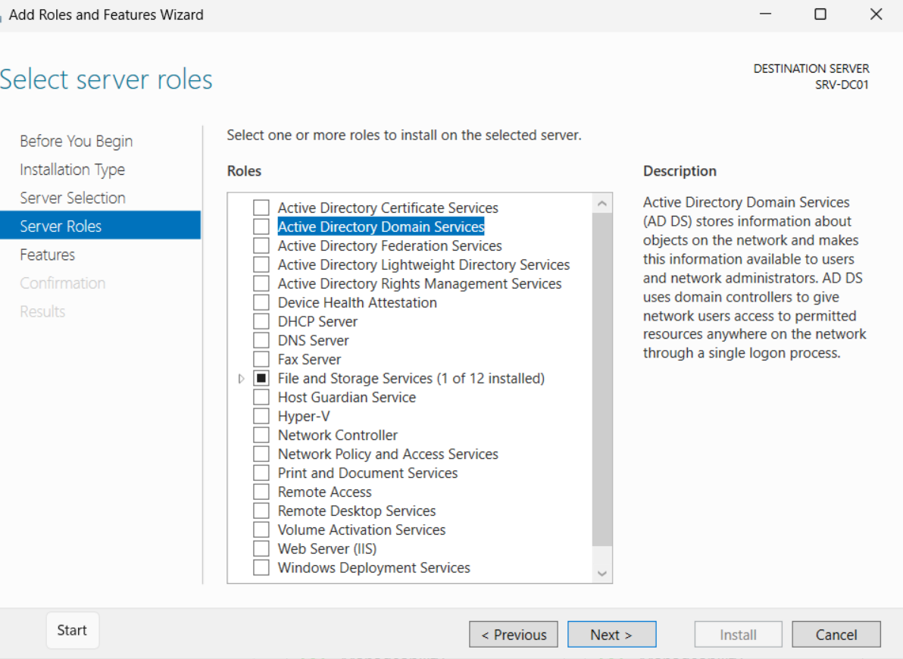*Active Directory and Domain Services role*

*AD roles and features*

*AD roles and features - confirmation*

After successful installation choose **Post-Deployment Configuration**

*Post-Deployment Configuration*

Enter **ad.skamt.se** as **Add a new Forest**

*AD Deployment Configuration*

Add a **Directory Services Restore Mode** password. Make a note of it somewhere safe. 

*Domain Controller Options*

We cannot create a delegation for the DNS server since it is the top of the AD zone.

*AD DNS Delegation*

Confirm the Netbiosname of the AD.
*Netbios name*

Confirm the standard choices for AD DS database, log files and sysvol
*AD DS, logfile and Sysvol settings*

Confirm promotion of the Active Directory
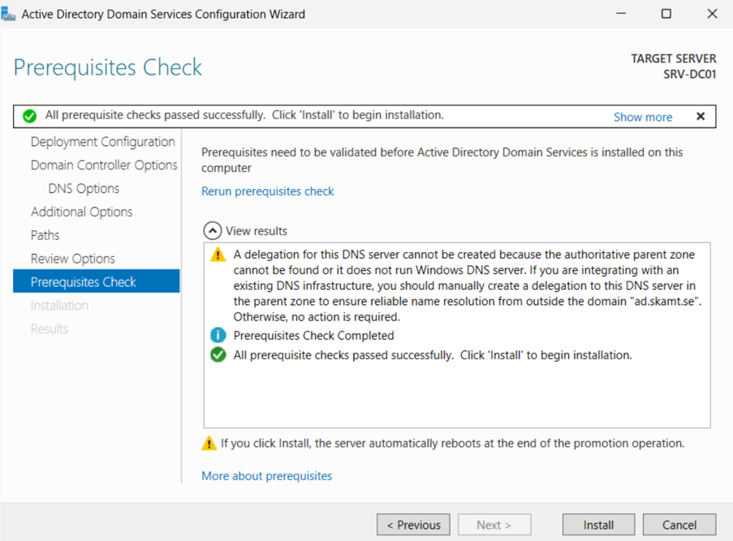*Confirm promotion of Active Directory*

The server will reboot automatically.

## Active Directory OU structure

The OU (Organizational Unit) structure in Active Directory mimicks the Organizational Structure of Skämt & Sido.
ad.skamt.se (Rightclick -> New -> Organisational Unit) in **Active Directory Users and Computers**

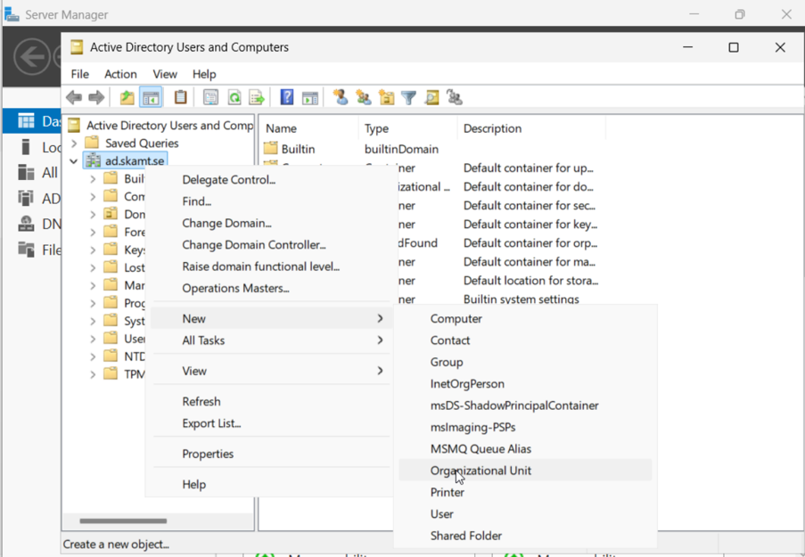*Active Directory Users and Computers Organisational Units structure*

We create a Computers, Groups and Users OU in each department.  
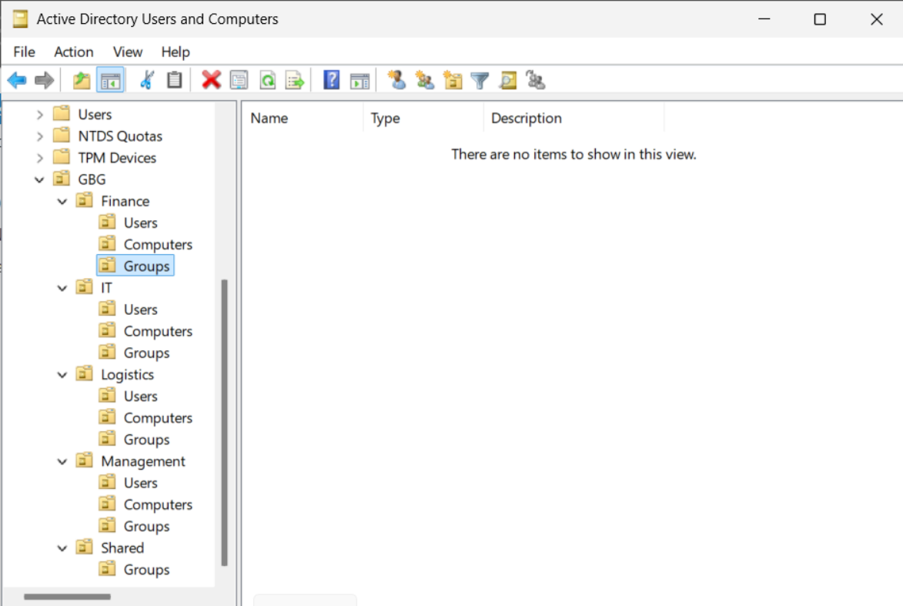*OU structure in ADUC*

The useraccounts, computeraccounts and securitygroups used for setting access to shared folders are placed in each departments sub OU.
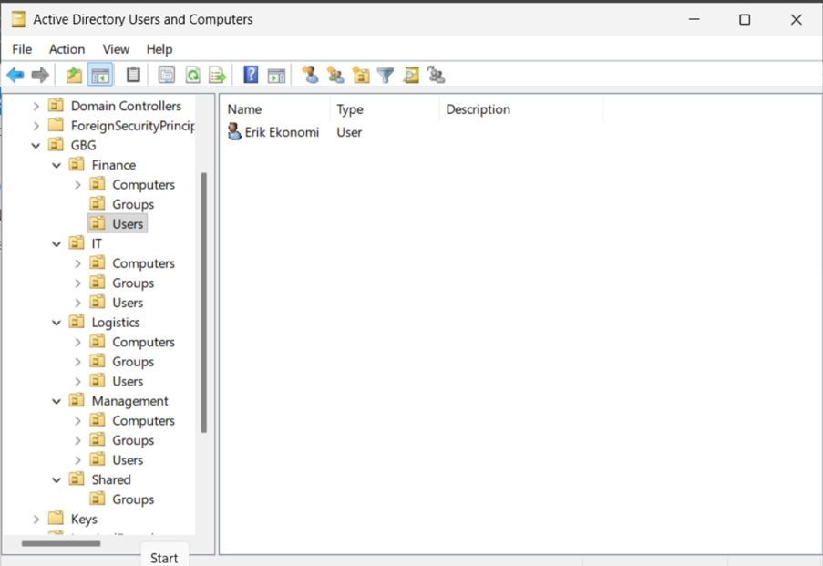*A useraccount in Finance - Users OU*

This will allow us to apply different settings using GroupPolicys to each department applied using the OU structure in AD.

### Groupmemberships

Each departments user is made a member of that departments securityGroup.
*Finance user in Ekonomi scuritygroup*

These groups provide department-based access to shared resources such as shared folders. 

A Special securitygroup called shared is created in each own OU which contain the other departments securitygroups. This group is used for access to a shared folder where all departmentmembers can share files. The members inherit the membership via their department securitygroup.
*The special securitygroup **Shared**'s members*

## Adding a clientcomputer to the domain.

In the client computer change the **primary DNS server** to the Domain controllers IP so the computer can find the domain.
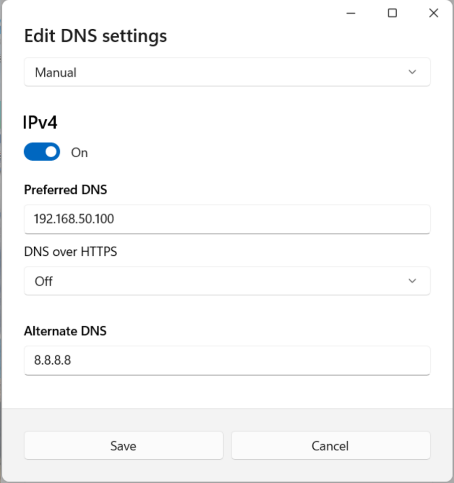*Network DNS settings on Client computer*

Run **sysdm.cpl** in the client computer.
 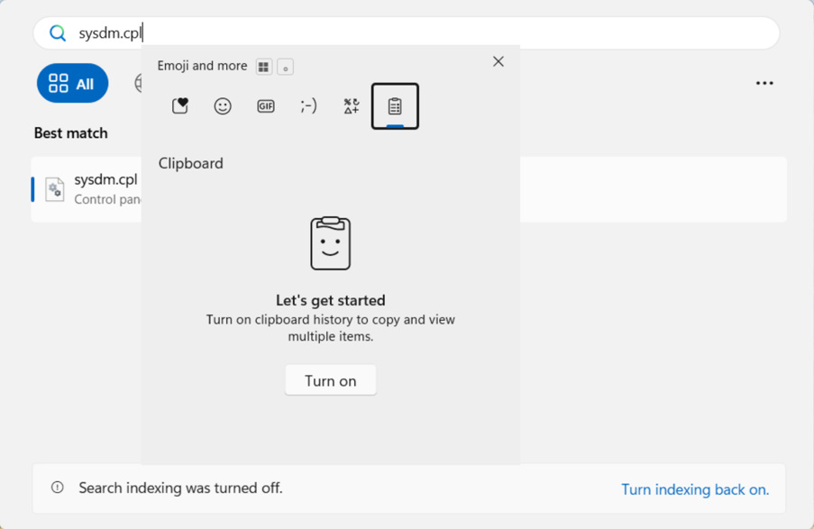*Run sysdm.cpl in client computer*

 *Computer Name/Domain Settings*

 Check the **Domain** checkbox and enter **ad.skamt.se** and click **Ok**
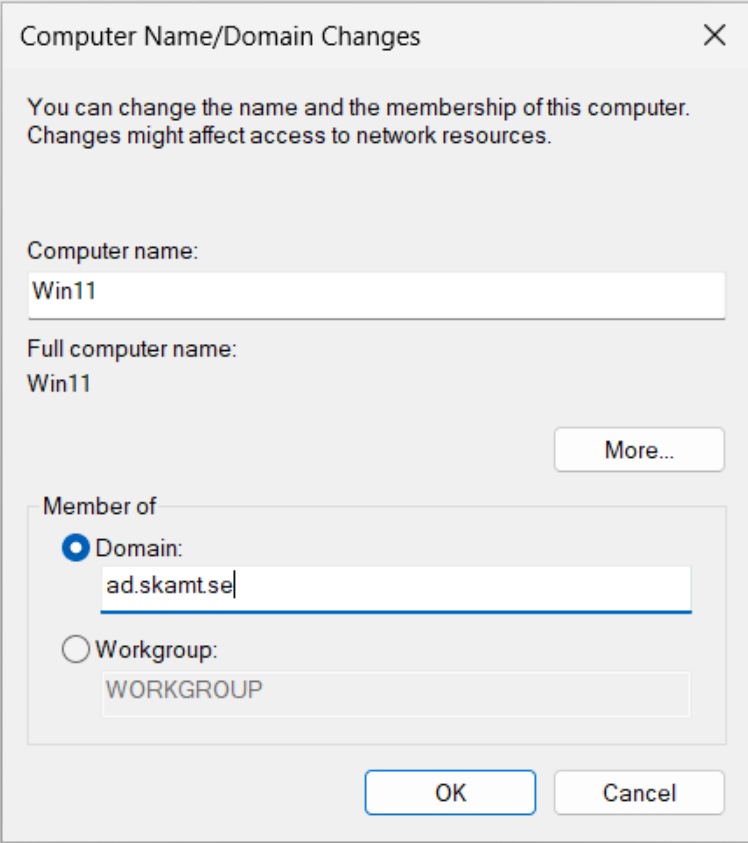*Enter domain **ad.skamt.se***

Enter the credentials of a user who has authorty to add a computer to the domain (*) and click **OK**
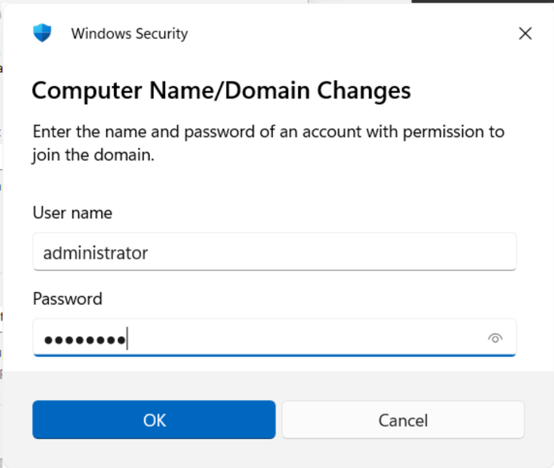*Enter domain credentials*

(*) *A normal domainuser can add up to 10 workstations to a AD domain.*

*Welcome to the **ad.skamt.se** domain*

Reboot the computer
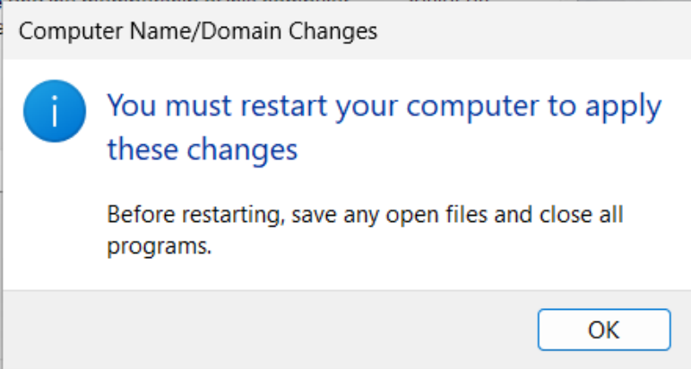*Reboot the computer*

### Move the computeraccount in Active Directory

In ADUC move the computeraccount from the default **Computers** container to the departments **Computers** OU (**). Disregard the warning.
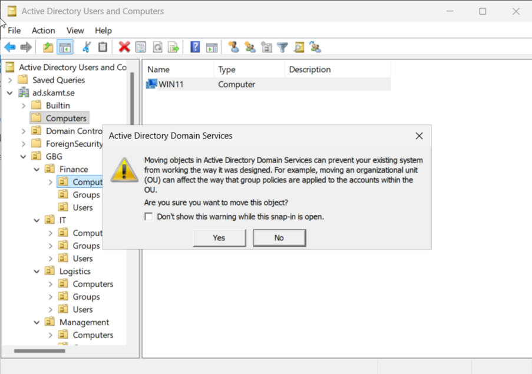*Moving the computer account in ADUC. Disregard Warning*

(**) A GroupPolicy cannot be applied to a Container in ActiveDirectory. Only to Organisational Units.

By moving the computeraccount into the AD OU hierarchy we can apply Group Policies that apply computer settings on a computerobject in that departments OU.

## Nätverks delade mappar (Windows)

I windows brukar man styra access möjligheten till delade nätverks mappar via NTFS (filsystemets) rättigheter snarare än nätverksrättigheterna eftersom NTFS rättigheterna erbjuder mycket mer granulära inställningar.

**1.	Skapa en root mapp för nätverksutdelning.**  

Skapa en root mapp för nätverksurdelning (tex Shared).  
Dela ut Mappen genom att högerklicka **Shared**-mappen, välja **Properties** och fliken **Sharing**.  
Välj **Advanced Sharing**.  
Bocka i **Share this folder** och ge den ett Share namn tex **"Shared\$"**  
$ gör att den inte är synlig (browseable) i nätverket.  
Välj **Permissions**.  
Välj **Authenticated Users** och ge dem **Full Control**.  

*Nätverksrättigheter för rootmappen **Shared***

I mappen **Shared** (Rotmappen för nätverksdelning) skapar du undermappar för varje mapp där avdelningarna kan spara sina filer.

För att hindra användare från att radera eller ändra nätverksrotmappen eller ADgruppernas rotmappar men tillåta att de skapar filer och undermappar inuti den, konfigureras avancerade NTFS-behörigheter genom att dela upp rättigheterna mellan själva rotmappen och dess innehåll.  

**2.	Inaktivera arv (Disable inheritance) i Nätverksrotmappen (Shared)** 

I mappen **shared** öppna egenskaper, Välj fliken **Security** och sen **Advanced**.
Inaktivera arv (**Disable inheritance**)
Välj alternativet ”Konvertera ärvda behörigheter till explicit behörighet” (**Convert inherited permissions into explicit permissions**), så att du behåller den grundläggande struktur som finns.

*Inaktivera ärvda NTFS rättigheter på rootmappen **shared***

-	Ta bort **Users (AD\Users)**
-	Lägg till **Authenticated Users** 

*Ta bort och lägg till grupper på NTFS rättigheterna på root mappen **shared***

**3. Sätt avancerade NTFS rättigheter i rootmappen.**

Ange följande avancerade NTFS rättigheter (för att de ska kunna läsa och lista innehåll).
-   Ange **AD\Authenticated Users** i **Principal** 
-	Ändra **Applies to** till **This folder only** 

Klicka på **Show advanced permisssions**.  
Kryssa för dessa avancerade NTFS rättigheterna
-	**List folder / read data**
-	**Traverse folder / execute file**
-	**Read attributes / Read extended attributes**
-	**Read permissions**  

Ta bort / kryssa ur 
-   **Full Control**
-	**Create files / Write data**
-	**Create folders / Append data**  
-   **Delete subfolders and files**
-   **Read permissions**  
-   **Write attributes**
-   **Write extended attributes**
-	**Delete**
-	**Change permissions**
-   **Take ownership**

*Sätt avancerade NTFS för ADgruppen **AD\Authenticated Users** rättigheter på rootmappen för nätverksutelning **Shared** (OBS. This folder Only)*

**4. Skapa och sätt avancerade NTFS rättigheter på ADgruppens gruppmapp Tex Ekonomi**
-   Skapa gruppmappen för AD-gruppen Tex **Ekonomi** i **Shared**-mappen
-   Öppna **Properties** (Egenskaper) för Ekonomi-mappen. Välj fliken **Security** och sen **Advanced**
-    Lägg till användargruppen **AD\Ekonomi** under **Permission entries** 
-    Välj **Edit**. Välj  ADgruppen **Ekonomi** i **Principal**  
Ändra **Applies to** till **This folder only** 

Välj **Show advanced permisssions**.  
Kryssa för dessa avancerade NTFS rättigheter
-	**Traverse folder / execute file**
-	**List folder / read data**
-	**Read attributes / Read extended attributes**
-	**Read permissions**
-	**Create files / Write data**
-	**Create folders / Append data**  
-   **Delete subfolders and files**
-   **Read permissions**  

Ta bort / kryssa ur:
-   **Full Control**
-   **Write attributes**
-   **Write extended attributes**
-	**Delete**
-	**Change permissions**
-   **Take ownership**

*Avancerade NTFS rättigheter för ADgruppen **AD\Ekonomi** i **Ekonomi** mappen applicerad på **This folder only*** 

Klicka **OK**

**5.	Ge behörighet till undermappar och filer i Gruppmappen (Ekonomi)**  
-   I **Ekonomi** mappen -> **Security** -> **Advanced** lägg till **AD\Ekonomi** igen. Välj **Edit** och ändra inställningen **Applies to** till **Subfolders and files** (Klicka **Show advanced permissions** för att se alla alternativ)

Kryssa i: 
-	**Traverse Folder / execute File**
-	**List Folder /read data**
-	**Read attributes**
-	**Read extended attributes**
-	**Create Files / write data**
-	**Create folders / append data**
-	**Write attributes**
-	**Write extended attributes**
-	**Delete subfolders and files**
-	**Delete**
-	**Read permissons**

Ta bort/Kryssa ur 
-   **Full Control**
-	**Change permissions**
-   **Take ownership**
    
*Avancerade NTFS rättigheter för **Ekonomi** mappen applicerad på **Subfolder and files***

Tryck **OK** och Spara ändringarna.  

Gör motsvarande steg 4 och 5 för de övriga gruppmapparna (IT, Ledning, Logistik, Gemensam) med motsvarande AD-grupper.

## Sammanfattning av logiken för NTFS
Rotmappen för nätverksutdelningen **Shared**:
- ADgruppen **Authenticated Users** har fullständiga nätverksdelningsrättigheter.  
Användarna har NTFS rättigheterna **Read and Execute** och **This folder Only** vilket gör att de får läsa och **traverse** men får inte skapa eller radera filer eller mappar.

*Övergripande Avancerade NTFS rättigheter för nätverksdelningsmappen **Shared***

Rotmappen för AD-gruppen **Ekonomi**:  

Man lägger till AD-gruppen två gånger.  
- En för **This folder only** - användarna har rätt att läsa **Read** och korsa **Traverse** Ekonomi-mappen och skapa nytt innehåll (filer/mappar) inne i den, men saknar rätten att radera eller ändra själva Ekonomi-mappen.
-	En gång för **Subfolder and files**:  
  Användarna har full behörighet att arbeta med, ändra och radera de filer och undermappar de (eller andra) skapar i Ekonomi-mappen.

*Övergripande Avancerade NTFS rättigheter för gruppmappen **Ekonomi*** (OBS. AD-gruppen **AD\Ekonomi** är tillagd två gånger)

## Aktivera Access-Based Enumeration 

**För att aktivera Access-Based Enumeration (Döljer mappar man inte har rättigheter till)**  
Öppna **Server Manager** och välj **File and Storage Services** i trädet till vänster.  
Välj **Shares** och sen högerklicka den utdelade mappen **shared$**  
Välj **Properties** - > **Settings**
Bocka i **Enable access-based enumeration**

*Aktivera **Access based- enumeration** på egenskaperna för **Shared$** i **Server Manager** -> **File and Storage Services***

Access-Based Enumeration styrs av NTFS rättigheterna på mapparna - det ändrar inga rättigheter.

## Skapa en Grupppolicy som mappar upp nätverksutdelningen
I **Group Policy Management** skapa en ny grupp policy (kalla den något lämpligt tex MapH)och öppna den i **Group Policy Management editorn**.
-  Expandera **User Configuration** -> **Preferences** -> **Windows Settings**
-  Högerklicka **Drive Map** och välj  **New** -> **Mapped Drive**  
-  Expandera **User Configuration** -> **Preferences** -> **Windows Settings**  
-  Högerklicka **Drive Map** och välj  **New** -> **Mapped Drive**

Välj **Update**
Fyll i nätverkssökvägen till den delade mappen **\\srv-dc01.ad.skamt.se\shared$**  
Bocka i **Reconnect** och ge den ett namn tex **Shared**
Välj en lämplig bokstav att använda tex. **H:**  
Bocka i **Show this Drive** och **No Change** under **Hide/Show all Drives**

*Group Policy Management editor*

Tryck på **Ok** och stäng **Group Policy Management Editorn**  

Länka din GPO till lämpligt ställe i AD strukturen.  
Iom att du vill att Den gemensamma mappen ska kopplas upp för alla i Skämt och Sido kan du länka den direkt på **GBG** Out.
Då appliceras den på samtliga användarobjekt under GBG Out.

***Group policy management**. Applicera **MapH** gruppolicyn på **GBG** OUt i ADt.*  
  
## Resultatet i klientdatorn 

Om man loggar in i en klientdator (**Win11**) som ligger under GBG OUt i ADt som  tex **ErikEko** som tillhör Ekonomi avdelningen så ser man följande under **This Computer**

*Inloggad som **ErikEko** från **Ekonomiavdelningen** i Win11 klienten*

**Shared$** är uppkopplad som **H:** med namnet Shared pga gruppolicyn.

I mappen **Shared** ser ErikEko **Ekonomi**-mappen och **Gemensam**-mappen.
ErikEko är medlem i ADgruppen **AD\Ekonomi** som har NTFS rättighet i **Ekonomi**-mappen.  
**AD\Ekonomi**-gruppen är medlem i **AD\Gemensam**-gruppen som har NTFS rättighet i **Gemensam**-mappen.

**Access Based Enumeration** döljer de mappar som Ad-användaren **ErikEko** inte har NTFS rättigheter till även om de finns på servern.

***Shared**-mappen som den faktiskt ser ut på **DC-SRV01***

## 5. Services and Technologies
Windows Server  
Active Directory Domain Services (AD DS)  
DNS (Domain Name System)  
Organizational Units (OUs)  
Active Directory security groups  
File sharing  
PowerShell administration  
Group Policy Objects (GPOs)  

## 6. Implementation Checklist
Install and configure Windows Server.  
Configure network settings and a static IP address.  
Install Active Directory Domain Services (AD DS).  
Promote the server to a domain controller.  
Configure DNS and verify domain name resolution.  
Create the domain structure and organizational units.  
Create user accounts and security groups.  
Configure shared folders and access permissions.  
Test access with different user accounts.  
Configure and test relevant Group Policy Objects.  
Document configuration decisions and troubleshooting steps.  

## 7. Testing and Troubleshooting

Verify that domain users can authenticate successfully, DNS resolution works correctly, and shared folders enforce the intended access restrictions.

Test both authorized and unauthorized access to confirm that permissions are applied correctly.

Document installation, domain, or network issues and the steps taken to resolve them.

## 8. Security Considerations
Apply the principle of least privilege.
Assign folder permissions through security groups wherever practical.
Restrict administrative privileges to authorized personnel.
Regularly review user memberships and folder permissions.
Test access restrictions using different user accounts.

## 9. Expected Outcome

The project aims to provide centralized identity management, reliable DNS resolution, structured user and group administration, and secure department-based file sharing for Skämt & Sido Transport AB.